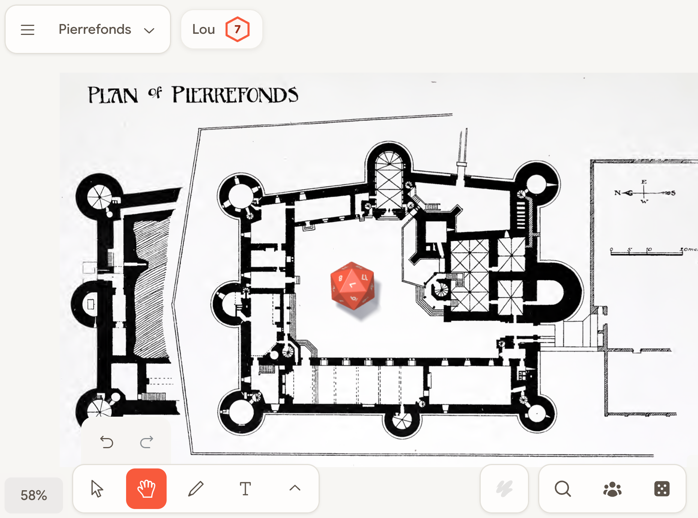

# Little Table

<!-- prettier-ignore -->
A whiteboard for tabletop RPGs, built on tldraw. 
No bloat and no forms to fill.

- Roll a d20 across the map with your mouse or finger.
- Write `/roll 3d6kh2` to roll 3 d6s and keep 2 highest.
- Find a text on this map, your character sheet or any other image thanks to magic of OCR.
- Chat with your friends.
- Ping them when they inevitably get lost.
- Summon them when they ignore your pings.
- Set landmarks to jump to.
- Scheme on a secret layer. Reveal your schemes to applause (or terror)
- Give your AI of choice MCP access to clean up your mess and compress the 50MB concept art of a goblin you forgot about.

[Say hi on the public board](https://littletable.top/) · [Make your own](https://littletable.top/boards)

## Development

[Run locally and test](docs/development.md) · [Internals](docs/internals.md)

## Licence

This repository's code has no licence yet. Deployments need their own
[tldraw licence key](https://tldraw.dev/sdk-features/license-key).
See the licences for [Outfit](client/src/theme/fonts/OFL.txt),
[Google Sans Flex](client/src/theme/fonts/Google-Sans-Flex-OFL.txt) and the
[text recognition engines](docs/internals.md#self-hosted-files).
