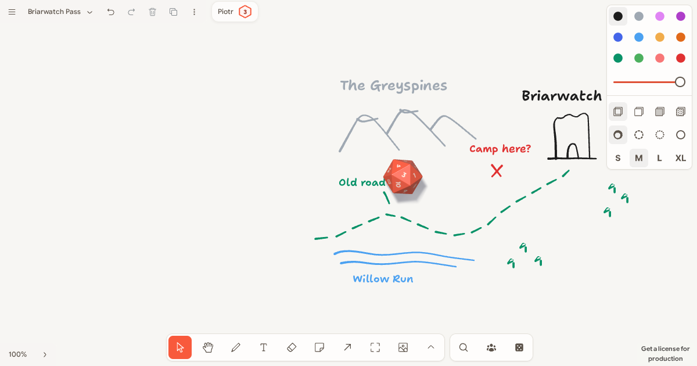

# Little Table

A shared whiteboard with dice for tabletop RPGs. Sketch the road to Briarwatch,
mark where the party makes camp, and roll a d20 to see what finds them there.

[Try the public board](https://littletable.top/). You can draw straight away.
Anyone can join, and drawings disappear after two days.

[Make a board for your game](https://littletable.top/boards). Sign in, choose
**New board**, and send the URL to your players. Anyone with the link can join
with just a name. Use the **Secret layer** to mark an ambush only you can see.

## Development

[Run locally and test](docs/development.md) · [Deploy Little Table](docs/deployment.md) · [Connect a host app](docs/hosting.md) · [Internals](docs/internals.md)

## Licence

This repository's code has no licence yet. Deployments need their own
[tldraw licence key](https://tldraw.dev/sdk-features/license-key).
See the licences for [Outfit](client/src/theme/fonts/OFL.txt),
[Google Sans Flex](client/src/theme/fonts/Google-Sans-Flex-OFL.txt) and the
[text recognition engines](docs/internals.md#self-hosted-files).
