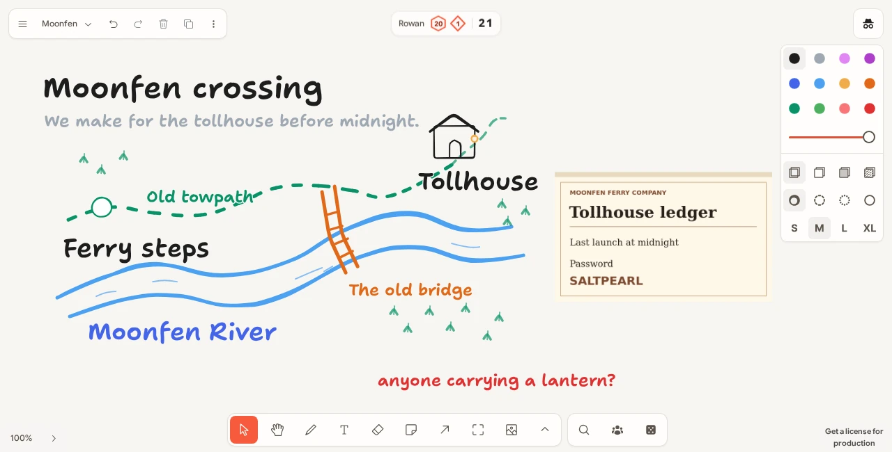
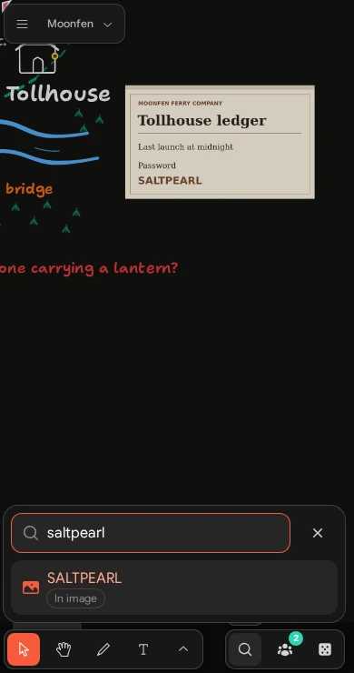
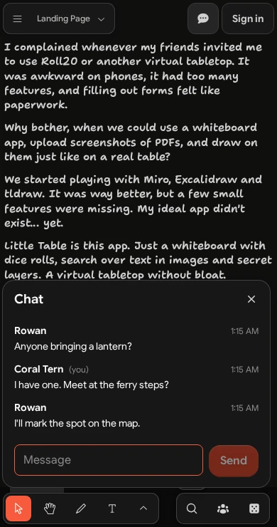

# Little Table

Little Table is a shared whiteboard with dice for tabletop RPGs. Drop a map on
the board and ask the party where they cross the river. A player can circle the
ford and roll for the crossing where everyone can see the result.

[Open the public board](https://littletable.top/) to draw alongside other
visitors. You get a guest name automatically. Drawings fade after a day and
disappear after two.

[Start a board for your group](https://littletable.top/boards). Sign in, choose
**New board**, then send the board URL to your players. Anyone with the link
can join with just a name. As the owner, you can keep your notes on the secret
layer while the group draws on the map.

  
  

## Development

[Run locally and test](docs/development.md) · [Deploy Little Table](docs/deployment.md) · [Connect a host app](docs/hosting.md) · [Internals](docs/internals.md)

## Licence

This repository's code has no licence yet. Deployments need their own
[tldraw licence key](https://tldraw.dev/sdk-features/license-key).
See the licences for [Outfit](client/src/theme/fonts/OFL.txt),
[Google Sans Flex](client/src/theme/fonts/Google-Sans-Flex-OFL.txt) and the
[text recognition engines](docs/internals.md#self-hosted-files).
